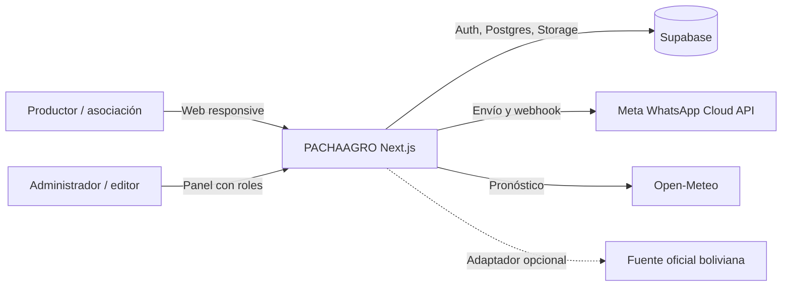
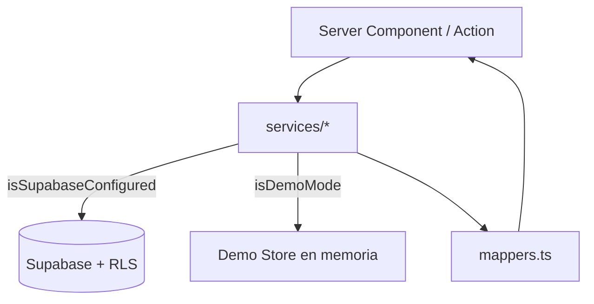
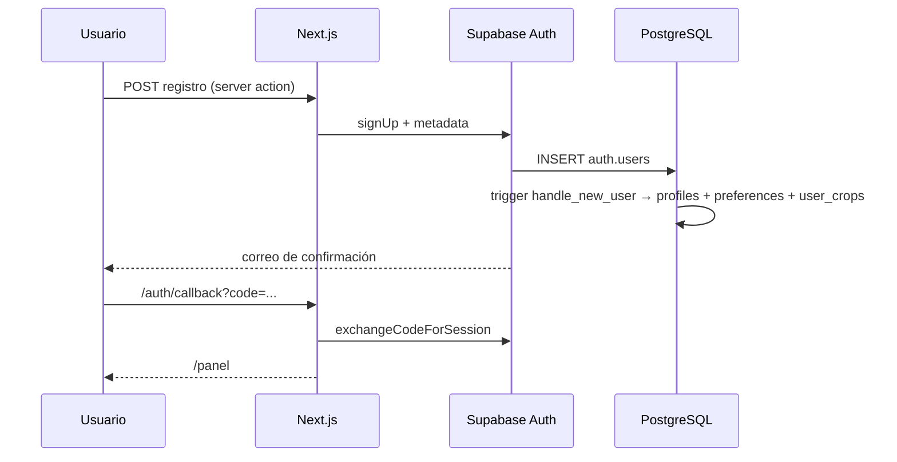
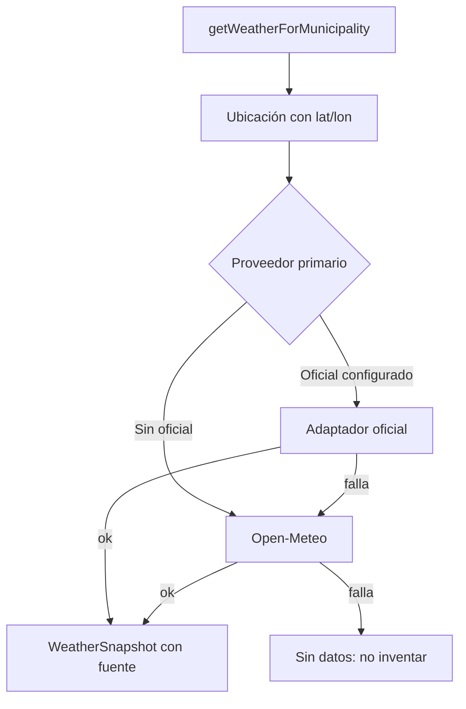
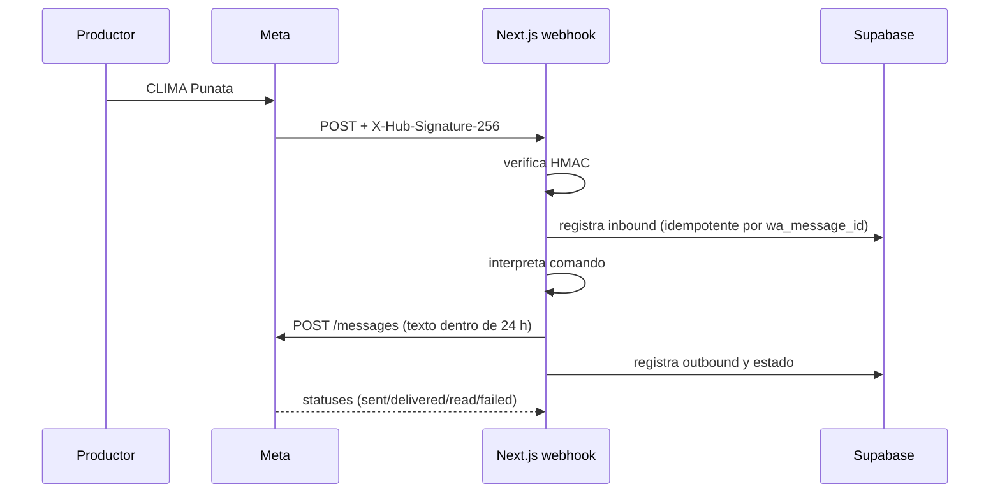

# Arquitectura de PACHAAGRO

## 1. Objetivo y alcance

PACHAAGRO es una aplicación monolítica modular sobre Next.js (App Router) que
resuelve dos necesidades del track **Ayuda Tecnológica**:

1. **Comunicación:** llevar alertas, anuncios, reuniones y avisos comunitarios a
   productores de toda Bolivia, segmentados por ubicación y cultivo.
2. **Educación:** ofrecer una biblioteca agrícola filtrable, con fuentes y
   advertencias para no presentar recomendaciones generales como instrucciones
   oficiales.

La arquitectura prioriza un MVP desplegable, sin microservicios. Supabase cubre
PostgreSQL, autenticación, almacenamiento y autorización a nivel de fila; Vercel
ejecuta el frontend y las funciones de servidor.

### Fuera de alcance

- Diagnóstico fitosanitario automático o recomendaciones de dosis.
- Emisión de alertas meteorológicas oficiales.
- Automatización de WhatsApp Web o canales no oficiales.
- Aplicación móvil nativa (la web es responsive y ligera).

---

## 2. Vista de contexto



No existe un servidor intermedio propio: las funciones de Next.js ejecutan la
lógica de aplicación y hablan con los servicios externos.

---

## 3. Capas

```text
app/            Presentación y rutas (Server Components + Client Components)
features/       Casos de uso por dominio + formularios y server actions
services/       Acceso a datos, mappers, clima y WhatsApp
lib/            Infraestructura transversal: env, auth, Supabase, validación
types/          Contratos de dominio compartidos
supabase/       Esquema, RLS, Storage y seeds versionados
components/     UI reutilizable sin lógica de negocio
tests/          Pruebas unitarias de reglas puras
```

Reglas de dependencia:

- `app` y `features` pueden importar `services`, `lib` y `components`.
- `services` no importa componentes ni páginas.
- `lib` no importa `app`.
- Los módulos con secretos (`lib/env`, `lib/supabase/admin`,
  `services/*`) incluyen `server-only` o solo se invocan desde el servidor.
- Los componentes de cliente no reciben objetos de base de datos con campos
  sensibles; reciben DTOs explícitos.

### Estrategia de datos dual

`services/*` contiene una capa de acceso que responde con Supabase cuando está
configurado o con el almacén DEMO en caso contrario. Los mappers convierten
`snake_case` de PostgreSQL a `camelCase` de dominio.



El modo demo permite presentar el flujo sin credenciales, pero **no es un modo
de producción**: los cambios viven en el proceso y los envíos son simulados.

---

## 4. Rutas principales

| Ruta | Acceso | Propósito |
|---|---|---|
| `/` | público | Landing, beneficios, alertas, educación, WhatsApp, cobertura |
| `/alertas`, `/alertas/[slug]` | público | Alertas activas y comunicados |
| `/biblioteca`, `/biblioteca/[slug]` | público | Biblioteca con filtros |
| `/whatsapp` | público | Explicación del bot y comandos |
| `/cobertura` | público | Mapa Leaflet y cobertura |
| `/login`, `/registro` | público | Autenticación y alta de productor |
| `/panel/*` | autenticado | Inicio, anuncios, reuniones, clima, biblioteca, perfil, notificaciones |
| `/admin/*` | admin / editor | Métricas, publicaciones, alertas, reuniones, biblioteca, usuarios, notificaciones |
| `/api/weather` | público limitado | Consulta climática validada |
| `/api/health` | público | Estado de configuración sin secretos |
| `/api/whatsapp/webhook` | Meta | Verificación y recepción firmada |
| `/auth/callback` | Supabase | Canje de código de confirmación |

Los layouts aplican autorización server-side. El middleware refresca la sesión
de Supabase y frena el acceso anónimo a `/panel` y `/admin`. El rol se vuelve a
validar en cada layout y acción sensible.

---

## 5. Autenticación y autorización

### Producción (Supabase Auth)



- El rol **nunca** se toma de metadata del usuario: el trigger fuerza
  `producer`. Solo un administrador puede cambiarlo.
- Un trigger adicional impide que un usuario modifique su propio rol, correo o
  marca `is_demo`.
- Las políticas RLS usan funciones `security definer` (`current_role`,
  `is_admin`, `can_manage_content`) para evitar recursión y validar permisos.

### Modo demostración

- Cookie HttpOnly `pacha_demo_profile` con el ID de una cuenta semilla.
- Los usuarios creados en demo se guardan en memoria y reciben sesión temporal.
- No hay datos de producción ni secretos involucrados.
- El banner global y los textos de cada módulo indican el modo.

### Matriz de permisos

| Capacidad | Admin | Productor | Asociación | Editor |
|---|:---:|:---:|:---:|:---:|
| Leer contenido publicado | ✅ | ✅ | ✅ | ✅ |
| Editar su perfil y preferencias | ✅ | ✅ | ✅ | ✅ |
| Crear/editar publicaciones | ✅ | — | — | ✅ |
| Crear/editar reuniones | ✅ | — | — | — |
| Crear/editar alertas | ✅ | — | — | — |
| Crear/editar biblioteca | ✅ | — | — | ✅ |
| Gestionar roles | ✅ | — | — | — |
| Ver/operar notificaciones | ✅ | — | — | — |
| Acceder a `/admin` | ✅ | — | — | ✅ (contenido) |

La tabla se implementa en tres capas: navegación condicionada, comprobación en
layouts/actions y políticas RLS.

---

## 6. Flujos funcionales

### Comunicación segmentada

1. El editor crea una publicación y define `audience_scope`.
2. PostgreSQL valida que existan las claves requeridas para ese alcance.
3. El panel del productor consulta publicaciones publicadas y no vencidas y
   aplica `announcementMatchesUser`.
4. El administrador puede disparar una notificación por WhatsApp; se vuelve a
   filtrar por alcance, consentimiento e interés.

Reglas de alcance:

| Alcance | Criterio |
|---|---|
| `national` | Todos |
| `department` | Mismo departamento |
| `municipality` | Mismo municipio |
| `community` | Misma comunidad |
| `crop` | El cultivo está en `user_crops` |

### Clima



- `WeatherSnapshot` siempre incluye `fetchedAt`, `sourceName`, `sourceUrl` e
  `isOfficial`.
- La alerta **no** se deriva del pronóstico: solo se muestran filas de
  `weather_alerts` creadas por un administrador con fuente.
- Open-Meteo se cachea 30 min; la fuente oficial, 15 min.
- El endpoint público limita solicitudes por IP en memoria (30/min) y valida
  coordenadas.

### WhatsApp



- Los mensajes iniciados por la plataforma usan plantillas.
- Las respuestas a comandos usan texto libre dentro de la ventana de 24 horas.
- Sin credenciales, el cliente devuelve `simulated` y no realiza peticiones.
- La documentación operativa está en [`WHATSAPP.md`](WHATSAPP.md).

---

## 7. Diseño visual

- Paleta: verde profundo `#145A32`, verde agrícola `#27864A`, verde claro
  `#E7F3E8`, amarillo `#E8B949`, crema `#FBFAF5`.
- Tipografía: Fraunces para títulos (carácter editorial) y Manrope para texto.
- Componentes: tarjetas redondeadas, bordes suaves, etiquetas DEMO visibles,
  ilustraciones SVG propias y patrones topográficos.
- Estados: `loading.tsx`, `error.tsx`, `not-found.tsx`, botones pendientes,
  mensajes de éxito/error y estados vacíos explícitos.
- Accesibilidad: skip link, landmarks, `aria-current`, foco visible, contraste,
  formularios etiquetados, `prefers-reduced-motion` y navegación por teclado.
- Rendimiento: Server Components por defecto, Leaflet cargado dinámicamente,
  sin librerías de UI pesadas y CSS acotado.

---

## 8. Decisiones y compromisos

| Decisión | Motivo | Compromiso |
|---|---|---|
| Monolito Next.js | Menos superficie operativa para el MVP | Escalar verticalmente y por funciones serverless |
| Supabase | Auth + Postgres + RLS + Storage en un servicio | Dependencia del proveedor |
| Demo store en memoria | Presentar el producto sin credenciales | No persiste; se documenta en la UI |
| Proveedor climático desacoplado | Evitar inventar datos y permitir fuente oficial | Requiere contrato para la fuente boliviana |
| WhatsApp simulable | Desarrollo y demo sin cuenta Meta | No sustituye pruebas con plantillas reales |
| Sin ORM | Menos capa, SQL explícito y RLS nativo | Tipos generados manualmente |
| Server Actions + Route Handlers | Formularios simples y endpoints para integraciones | Validación duplicada controlada con Zod |

---

## 9. Riesgos y próximos pasos

1. **Verificar el contrato real de una fuente oficial boliviana.** Hoy el
   adaptador es configurable y documentado, pero no se afirma que exista una API
   pública compatible.
2. **Probar plantillas de WhatsApp en Meta.** El código usa parámetros de cuerpo
   posicionales; los textos deben coincidir exactamente con las plantillas
   aprobadas.
3. **Añadir recuperación de contraseña** con correo transaccional y plantillas
   de Supabase.
4. **Rate limiting distribuido** (Upstash/Vercel KV) si el tráfico crece; el
   límite actual del endpoint climático es en memoria.
5. **Generar tipos de Supabase** con `supabase gen types typescript` para
   eliminar los casts controlados de los mappers.
6. **Observabilidad**: Sentry/Logflare y alertas de fallos de webhook.
7. **Pruebas end-to-end** con Playwright para login, CRUD y consentimiento.
8. **Accesibilidad auditada** con axe y pruebas con usuarios reales.
