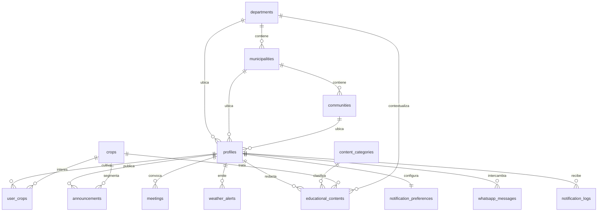

# Base de datos

PostgreSQL administrado por Supabase. Todo el esquema está versionado en
`supabase/migrations/` y los datos DEMO en `supabase/seed.sql`.

## 1. Migraciones

| Archivo | Contenido |
|---|---|
| `20261121000100_init.sql` | Extensiones, enums, tablas, constraints, índices, triggers y funciones |
| `20261121000200_rls.sql` | RLS, políticas, Storage y permisos |
| `20261121000300_reference_data.sql` | 9 departamentos, 32 municipios, comunidades, 12 cultivos y 8 categorías |
| `seed.sql` | Publicaciones, reuniones, alertas y contenidos DEMO (`is_demo = true`) |

### Aplicar en local con Supabase CLI

```bash
npx supabase start
npx supabase db reset     # migraciones + seed.sql
```

### Aplicar en un proyecto remoto

```bash
npx supabase link --project-ref <PROJECT_REF>
npx supabase db push
```

También puedes ejecutar los archivos en orden desde el SQL Editor. No edites una
migración ya aplicada: crea una nueva.

---

## 2. Modelo entidad-relación



`weather_alerts` y `announcements` también guardan `department_id`,
`municipality_id`, `community_id` y `crop_id` para segmentar el alcance.

---

## 3. Enums

| Enum | Valores |
|---|---|
| `user_role` | `admin`, `producer`, `association_manager`, `content_editor` |
| `announcement_type` | `announcement`, `communique`, `weather`, `meeting`, `event` |
| `audience_scope` | `national`, `department`, `municipality`, `community`, `crop` |
| `educational_content_type` | `guide`, `crop_info`, `care`, `calendar`, `pest`, `disease`, `good_practice`, `soil` |
| `alert_severity` | `info`, `moderate`, `severe`, `extreme` |
| `notification_channel` | `whatsapp`, `in_app` |
| `notification_kind` | `weather_alert`, `meeting`, `announcement`, `educational`, `system` |
| `notification_status` | `queued`, `sent`, `delivered`, `read`, `failed`, `simulated` |
| `message_direction` | `inbound`, `outbound` |

---

## 4. Tablas

### Referencia

- **departments**: `id`, `name`, `code` (2 letras), `slug`, `latitude`,
  `longitude`, timestamps.
- **municipalities**: FK a departamento. `unique (department_id, name)` y
  `unique (id, department_id)` para claves foráneas compuestas.
- **communities**: FK a municipio. `unique (municipality_id, name)` y
  `unique (id, municipality_id)`.
- **crops**: nombre, slug, nombre científico, descripción.
- **content_categories**: categorías administrables de la biblioteca.

### Personas

- **profiles**: PK = `auth.users.id`. Nombre, correo, teléfono normalizado
  (`^[1-9][0-9]{6,14}$`), rol, ubicación, avatar, `is_demo`, timestamps.
  Índice único parcial de teléfono para identificar usuarios en el webhook.
- **user_crops**: PK compuesta (`profile_id`, `crop_id`).
- **notification_preferences**: 1:1 con el perfil; consentimiento de WhatsApp,
  intereses y `consent_at`.

### Comunicación

- **announcements**: título, slug único, resumen, cuerpo, tipo, alcance,
  ubicación, cultivo, autor, `is_published`, `published_at`, `expires_at`.
  Restricciones de alcance y de publicación.
- **meetings**: título, descripción, inicio/fin, lugar, virtualidad, enlace
  https, ubicación, cultivo, autor.
- **weather_alerts**: título, descripción, severidad, **fuente obligatoria**,
  vigencia, ubicación, `is_active`.

### Educación

- **educational_contents**: título, slug, resumen, cuerpo, categoría, cultivo,
  departamento, tipo, minutos de lectura, portada, **nota de fuente**,
  publicación.

### Notificaciones

- **whatsapp_messages**: mensajes entrantes/salientes, `wa_message_id` único,
  teléfono, cuerpo, plantilla, estado, error, `is_simulated`.
- **notification_logs**: traza por usuario y tipo; `reference_id` apunta al
  contenido notificado sin FK polimórfica; estado, id del proveedor y error.

### Integridad jerárquica

Las claves foráneas compuestas evitan ubicaciones incoherentes:

```sql
foreign key (municipality_id, department_id)
  references municipalities (id, department_id);

foreign key (community_id, municipality_id)
  references communities (id, municipality_id);
```

Además hay `CHECK` para impedir un municipio sin departamento o una comunidad
sin municipio. Las acciones de aplicación validan la misma jerarquía con Zod y
consultas a los catálogos.

---

## 5. Índices principales

- `announcements (is_published, published_at desc)`.
- `announcements (department_id)`, `(municipality_id)`, `(crop_id)`, `(type)`.
- `meetings (starts_at)`, `(department_id)`.
- `weather_alerts (is_active, starts_at, ends_at)`.
- `educational_contents (is_published, updated_at desc)`, categoría y cultivo.
- `profiles (department_id)`, `(municipality_id)`, `(role)`, teléfono único.
- `notification_logs (created_at desc)`, `(profile_id)`, `(reference_id)`.
- `whatsapp_messages (phone)`, `(created_at desc)`, `(profile_id)`.

---

## 6. Triggers y funciones

| Función | Tipo | Propósito |
|---|---|---|
| `set_updated_at()` | trigger | Actualiza `updated_at` en perfiles, anuncios, reuniones, alertas, contenidos y preferencias |
| `handle_new_user()` | trigger `auth.users` | Crea perfil, preferencias y cultivos desde metadata; fuerza rol `producer` |
| `prevent_profile_escalation()` | trigger | Impide que un usuario cambie su propio rol, correo o `is_demo` |
| `current_role()` | security definer | Rol efectivo sin recursión RLS |
| `is_admin()` | security definer | Verificación de administrador |
| `is_staff()` | security definer | Staff general |
| `can_manage_content()` | security definer | Admin o editor |
| `can_manage_meetings()` | security definer | Admin o responsable de asociación |

### Alta de perfil

`handle_new_user()` lee `raw_user_meta_data`:

- `full_name`, `phone`.
- `department_id`, `municipality_id`, `community_id`.
- `crop_ids` (array JSON de UUID).
- `whatsapp_consent` (booleano).

Si una ubicación no coincide con la jerarquía, se descarta en lugar de romper el
registro. La metadata **no** puede asignar roles administrativos.

---

## 7. Row Level Security

RLS está habilitado en todas las tablas de negocio.

| Tabla | Lectura | Escritura |
|---|---|---|
| `departments`, `municipalities`, `communities`, `crops` | público | admin |
| `content_categories` | público | admin/editor (delete: admin) |
| `profiles` | propio o admin | propio (sin rol/correo/is_demo) o admin |
| `user_crops` | propio o admin | propio o admin |
| `announcements` | publicadas y vigentes; admin/editor ven borradores | admin/editor |
| `meetings` | público | admin o responsable autor |
| `weather_alerts` | activas y vigentes; admin ve todas | admin |
| `educational_contents` | publicados; admin/editor ven borradores | admin/editor |
| `notification_preferences` | propio o admin | propio o admin |
| `whatsapp_messages` | admin | solo `service_role` |
| `notification_logs` | propio o admin | solo `service_role` |

Las lecturas públicas usan la clave anónima. Ninguna operación confía en el rol
enviado por el cliente.

### Storage

| Bucket | Público | Escritura |
|---|---|---|
| `avatars` | sí | dueño de la carpeta `{auth.uid()}/...` |
| `educational-assets` | sí | admin/editor |

Límites: 2 MB para avatares (JPG/PNG/WebP) y 5 MB para material educativo.

---

## 8. Datos DEMO

- Todo registro de ejemplo utiliza `is_demo = true` y la interfaz muestra la
  etiqueta **DEMO**.
- Los catálogos geográficos y de cultivos son datos de referencia reales y no
  se marcan como demo.
- `seed.sql` no crea usuarios de `auth.users`; las cuentas demo viven en la capa
  de aplicación cuando no hay Supabase.
- Para producción, no ejecutes `seed.sql` o elimina los registros antes de
  presentar información real.

Limpieza opcional:

```sql
delete from public.announcements where is_demo = true;
delete from public.meetings where is_demo = true;
delete from public.weather_alerts where is_demo = true;
delete from public.educational_contents where is_demo = true;
```

---

## 9. Crear el primer administrador

1. Crea el usuario desde **Supabase → Authentication → Users** o mediante el
   formulario de registro.
2. Ejecuta en el SQL Editor:

```sql
update public.profiles
set role = 'admin'
where email = 'administrador@dominio.bo';
```

3. Inicia sesión. El panel `/admin` estará disponible.

Para un responsable de asociación o editor:

```sql
update public.profiles set role = 'association_manager'
where email = 'asociacion@dominio.bo';

update public.profiles set role = 'content_editor'
where email = 'editor@dominio.bo';
```

---

## 10. Operación y mantenimiento

- **Respaldos:** activa Point-in-Time Recovery en Supabase para producción.
- **Tipos:** `npx supabase gen types typescript --linked > types/database.generated.ts`
  y sustituye los casts de `services/mappers.ts` cuando se genere.
- **Migraciones limpias:** prueba `supabase db reset` antes de cada PR que
  modifique el esquema.
- **Datos personales:** el teléfono y el correo son datos personales. No los
  expongas en endpoints públicos ni logs.
- **Borrados:** las cuentas se eliminan desde Supabase Auth; `profiles` cae en
  cascada. Los registros históricos de logs conservan `profile_id = null` por
  `on delete set null`.
